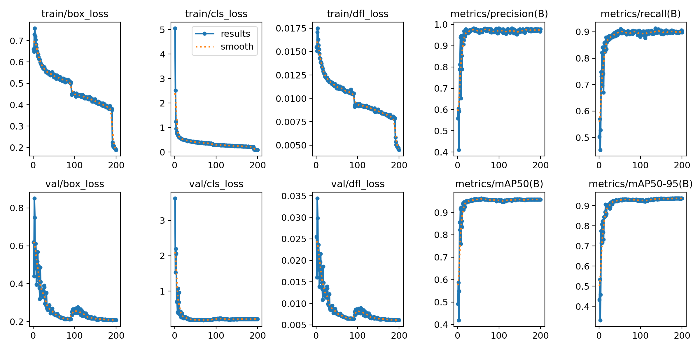
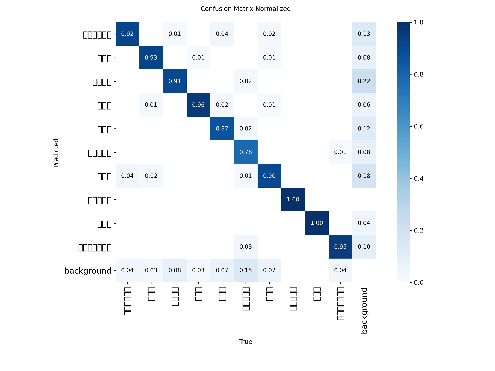

# YOLO26n 番茄病害检测模型训练报告

> 训练日期：2026-10-10 ~ 2026-10-11
> 训练平台：AutoDL 云 GPU（RTX 4090 24GB）
> 状态：训练完成，模型已部署至后端并通过全链路测试

---

## 一、概述

本次训练使用 **YOLO26n**（ultralytics 8.4.174，NMS-free 端到端检测头）在番茄叶片病害数据集上完成 **200 轮完整训练**（禁用早停），最终模型：

| 指标 | 数值 |
|------|------|
| mAP50 | **95.78%** |
| mAP50-95 | **93.67%** |
| Precision | **97.63%** |
| Recall | **89.88%** |
| 最佳轮次 | **epoch 182**（共 200 轮） |

最佳权重已部署至 `backend/data/model/best.pt`，后端已切换为真实推理模式（`YOLO_USE_MOCK=false`）。

---

## 二、数据集

- **来源**：Tomato Leaf Disease（Kaggle），本地打包为 `Tomato_Leaf_Disease.zip`（466MB）上传至 AutoDL
- **规模**：train **12168** 张 / val **3041** 张，共 **10 类**
- **类别**：服务器训练版 `data.yaml` 使用中文类别名（与后端病害档案、`yolo_service` 类别顺序完全对齐）：
  细菌性斑点病、早疫病、健康叶片、晚疫病、叶霉病、花叶病毒病、斑枯病、蜘蛛螨危害、靶斑病、黄化曲叶病毒病

---

## 三、训练环境与配置

### 3.1 环境

| 项 | 配置 |
|----|------|
| GPU | RTX 4090 24GB |
| 框架 | ultralytics 8.4.174（YOLO26） |
| 优化器 | MuSGD（`optimizer=auto` 自动选择） |
| 混合精度 | AMP 开启 |
| 预训练权重 | yolo26n.pt |

### 3.2 关键超参（`args.yaml`）

| 参数 | 值 | 说明 |
|------|-----|------|
| epochs | 200 | 跑满，用于轮次-精度对比分析 |
| batch | 64 | 第二次训练加大 batch（首次为 16） |
| imgsz | 640 | |
| workers | 16 | |
| cache | true | 503GB RAM 全量缓存，加速 IO |
| save_period | 20 | 每 20 轮存一次 checkpoint |
| patience | 30 → 999 | 见下文训练过程 |
| close_mosaic | 10 | 最后 10 轮关闭 mosaic |
| 默认增强 | mosaic 1.0 / fliplr 0.5 / hsv / translate 0.1 / scale 0.5 / erasing 0.4 | |

---

## 四、训练过程（两段式）

1. **第 0~91 轮（patience=30）**：best 出现在第 61 轮（mAP50-95 0.93242），此后 30 轮无提升，第 91 轮触发早停。
2. **Checkpoint 修复后续训（第 92~200 轮）**：早停结束时 `last.pt` 的 `epoch` 被置为 `-1`（已完结标记）且丢失 optimizer 状态，直接 resume 会崩溃；修复 checkpoint 标记并将 patience 改为 999（禁用早停）后，从第 92 轮成功续训，`108 epochs completed in 2.882 hours`，跑满 200 轮。

累计训练时长约 **5.3 小时**（前段 91 轮约 2.4h + 后段 109 轮约 2.9h）。

### 4.1 关键轮次指标（摘自 `results.csv`）

| epoch | Precision | Recall | mAP50 | mAP50-95 | 备注 |
|-------|-----------|--------|-------|----------|------|
| 1 | 0.5576 | 0.5029 | 0.4922 | 0.4318 | 起点 |
| 12 | 0.9100 | 0.8304 | 0.9180 | 0.8439 | 快速收敛段 |
| 30 | 0.9755 | 0.8845 | 0.9516 | 0.9181 | |
| 61 | 0.9720 | 0.9009 | 0.9608 | 0.9324 | 原 patience 段 best |
| 91 | 0.9668 | 0.8993 | 0.9563 | 0.9307 | 早停触发点 |
| 130 | 0.9757 | 0.8970 | 0.9519 | 0.9282 | 续训中段（波动） |
| **182** | **0.9763** | **0.8988** | **0.9578** | **0.9367** | **全局 best** |
| 199 | 0.9664 | 0.9050 | 0.9568 | 0.9361 | 末轮（与 best 接近） |

### 4.2 早停 vs 跑满 200 轮对比结论

- 早停点（ep91）mAP50-95 为 0.9307，**跑满后（ep182）提升至 0.9367（+0.6 个百分点）**；
- mAP50-95 在续训段仍能缓慢爬升（ep61 0.9324 → ep182 0.9367），验证了「对比实验需跑满 200 轮」的决策；
- 末轮（ep199/200）与 best 差距极小（0.9361 vs 0.9367），训练已充分收敛，无过拟合迹象（val loss 平稳）。

---

## 五、与放弃的首次训练对比

| 项 | 首次（已放弃） | 本次 |
|----|---------------|------|
| run 名 | yolo26n_tomato | yolo26n_tomato_b64 |
| batch | 16 | 64 |
| 实际轮次 | 16 轮后中断 | 200 轮完成 |
| ep16 时 mAP50 / mAP50-95 | 0.9474 / 0.9057 | —（ep30 已达 0.9516 / 0.9181） |

首次训练因用户决定加大 batch 从头重跑而放弃，其 epoch15 产物保留于 `training/yolo26n_tomato/`（best.pt 15.2MB，曾被临时接入后端验证链路）。

### 弱类别

**花叶病毒病** 为最弱类（mAP50-95 约 0.776），主要原因是验证集中该类样本最少（85 张图）。后续可通过过采样或补充样本改善。

---

## 六、产物清单

全部训练产物已从 AutoDL 拉回本地 `training/yolo26n_tomato_b64/`（22 个文件，约 18.7MB）：

| 文件 | 说明 |
|------|------|
| `weights/best.pt` | 最佳权重（= epoch 182），已部署后端 |
| `weights/last.pt` | 末轮权重（= epoch 200） |
| `results.csv` / `results.png` | 全 200 轮指标数据与曲线 |
| `BoxF1_curve.png` / `BoxPR_curve.png` / `BoxP_curve.png` / `BoxR_curve.png` | F1 / PR / P / R 曲线 |
| `confusion_matrix.png` / `confusion_matrix_normalized.png` | 混淆矩阵（原始/归一化） |
| `train_batch*.jpg` / `val_batch*_labels.jpg` / `val_batch*_pred.jpg` | 训练/验证批次可视化 |
| `args.yaml` / `labels.jpg` | 训练超参 / 类别分布 |

---

## 七、部署与验证

### 7.1 后端部署

- 权重：`backend/data/model/best.pt`（约 5.2MB）
- 配置（`backend/config.py`）：`YOLO_USE_MOCK=false`、`YOLO_CONF_THRESHOLD=0.5`、`YOLO_IOU_THRESHOLD=0.45`
- 服务层（`backend/services/yolo_service.py`）：真实推理分支使用 `result.plot()` 绘制结果图，`model_version='yolo26n-tomato'` 随记录落库

### 7.2 测试结果（2026-10-11）

| 层级 | 结果 |
|------|------|
| API 全链路 | 4/4 通过：登录 → 上传 → 检测 → 历史 → 统计；早疫病 0.92 / 健康叶片 0.96 / 斑枯病 0.97 / 黄化曲叶 0.97；单图约 380ms（首图 9.6s 含模型加载） |
| Web UI | 全流程通过：登录 → 上传 val 集图片 → 真实检测（叶霉病 53.8%）→ 结果图绘制 → 病害档案联动 → 历史落库 |
| H5 UI | 登录、首页统计（累计 44 / 病害 42 / 健康 2，实时正确）、检测页渲染通过；history/chat 页存在 dev 模式卡死问题（见下） |

---

## 八、遗留问题与建议

1. **H5 history / chat 页 dev 模式卡死**：直达 `#/pages/history/index`、`#/pages/chat/index` 页面挂起（后端 API 秒回正常、vite 无编译报错），需单独排查；build 产物存在，生产模式未必复现
2. **H5 首页"最近检测"时间显示偏差**：1 分钟前记录显示"8小时前"，疑似 UTC 时区解析偏移
3. **管理端 category_distribution 全为 unknown**：历史记录缺 category 字段所致，待数据清洗
4. **弱类改善**：花叶病毒病（85 张 val 图）可通过过采样 / 补数据提升
5. **AutoDL 实例**：产物已全量拉回，实例可关机节省费用
6. **视频检测**：按项目约定不在 Web 端实现，预留移动端 App 后续开发

---

## 附：指标曲线与混淆矩阵

